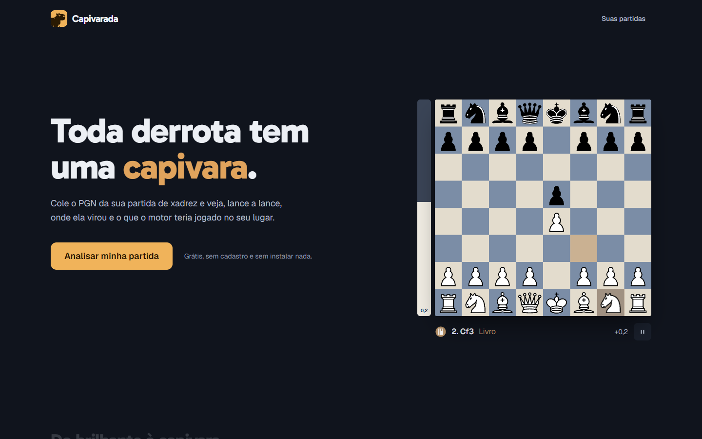
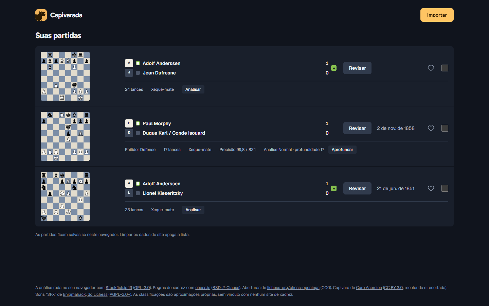
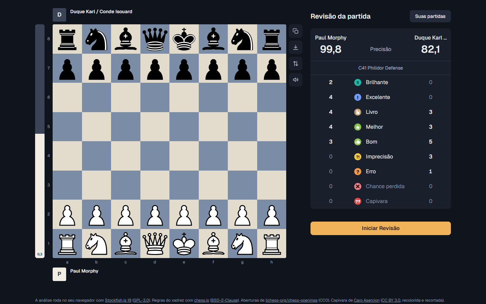
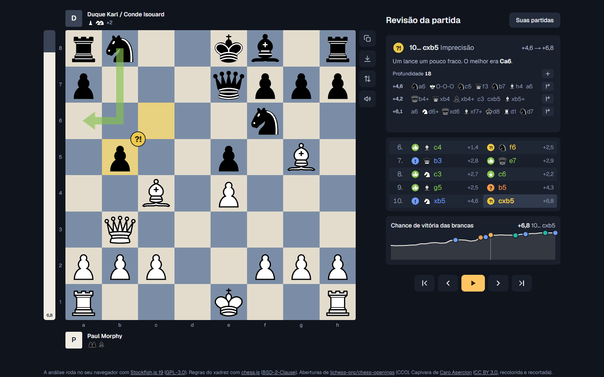

# Capivarada

Análise de partidas de xadrez. Cole um PGN e veja a precisão de cada jogador e a classificação de cada lance
(Brilhante, Excelente, Livro, Melhor, Bom, Imprecisão, Erro, Chance
perdida, Capivara). Tudo roda no navegador, sem servidor.

## Prints

## Comandos

- `npm run dev`: desenvolvimento
- `npm test` / `npm run lint`: testes e lint
- `npm run build`: site estático em `out/`
- `npm run engine`: baixa o Stockfish para `public/engine/` (já versionado)
- `npm run openings`: gera `public/openings.json` (já versionado)

## Páginas

- `/`: landing page
- `/partidas`: lista de partidas e análise

## Partidas salvas

Cada partida adicionada fica no IndexedDB do navegador, com o PGN original e a
análise (`src/lib/library.ts`). Ao mudar limiares ou fórmulas, aumente
`ANALYSIS_VERSION` em `src/lib/savedGame.ts` para as análises antigas serem
refeitas ao abrir.

## Variantes

Na revisão, mover uma peça no tabuleiro (arrastando ou clicando) abre uma variante. Cada
lance dela é analisado com a profundidade da partida e classificado pelas mesmas regras.
Variantes não são salvas: existem até voltar à partida.

## Profundidade

Na lista, cada partida pode ser refeita na profundidade seguinte (Rápida, Normal,
Profunda) em segundo plano, uma por vez e com metade dos motores
(`src/lib/backgroundJobs.ts`). A fila se perde ao fechar a página.

Aumentar a profundidade de um lance refaz só as posições antes e depois dele, com 4
vezes mais nós a cada clique (`src/lib/deepen.ts`). Os vizinhos não são reclassificados
e nada disso é salvo.

## Como classifica

Imprecisão, Erro e Capivara usam os cortes do Lichess (0,05, 0,10 e 0,15 pontos
esperados perdidos); abaixo disso, é Bom. Perder ou permitir um mate forçado segue
as regras do Lichess (`src/lib/analysis/mate.ts`). Os critérios de Brilhante,
Excelente e Chance perdida são aproximações; os limiares ficam em
`src/lib/analysis/thresholds.ts`. Lance único é "Forçado" e fica fora do resumo.

A precisão combina, como o Lichess, a média ponderada pela volatilidade e a média
harmônica, na proporção 50/50, mas sem contar livro e forçados. O lance nº 1 do
motor sempre vale 100.

## Licenças

Este projeto é GPL-3.0 ou posterior (`LICENSE`). Materiais de terceiros mantêm as
suas licenças: o Stockfish.js 19 é GPL-3.0 (`public/engine/COPYING.txt`). O chess.js, de
Jeff Hlywa, é BSD-2-Clause (`public/licenses/chess.js.txt`). As aberturas vêm de
`lichess-org/chess-openings` (CC0). A capivara é de Caro Asercion
(game-icons.net), CC BY 3.0, recolorida e recortada. Os sons são o conjunto "SFX"
do Lichess, de Enigmahack, AGPL-3.0 ou posterior (`public/sounds/sfx`).
